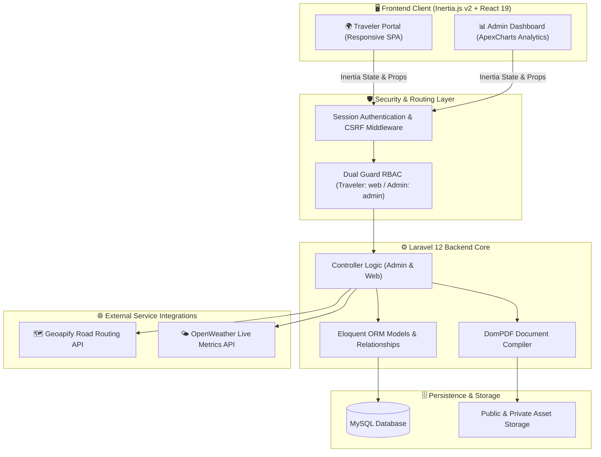
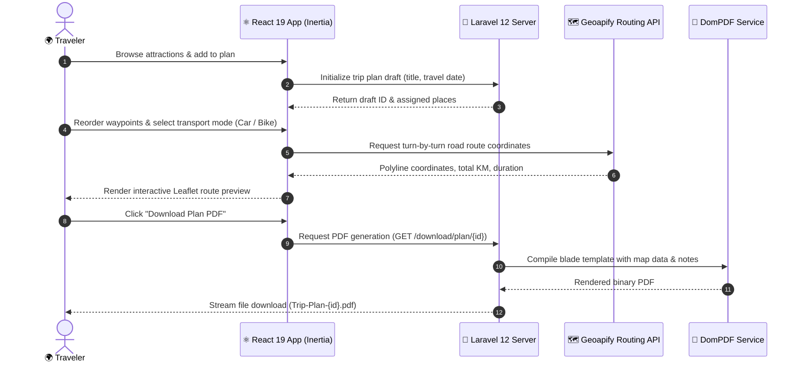

# 🌍 Local Explorer — Smart Travel Discovery & Itinerary Planning Platform

[](https://github.com/thusitha-dayan-dev/Local-Explorer)
[](https://laravel.com)
[](https://inertiajs.com)
[](https://react.dev)
[](https://tailwindcss.com)
[](https://www.typescriptlang.org)
[](tests)
[](LICENSE)

> [!NOTE]
> **🎓 Academic Project Showcase**: **Local Explorer** was conceptualized, designed, and engineered by **Thusitha Dayan** as an in-depth **University Undergraduate Study Project**. It was developed to demonstrate advanced software engineering practices, GIS spatial routing integration, dual-guard role-based access control (RBAC), and modern reactive web architecture.

---

## 📖 Executive Summary & Motivation

### The Problem
Regional cultural tourism in destinations like **Dambulla, Sigiriya, and Sri Lanka's Central Cultural Triangle** suffers from digital fragmentation. Travelers encounter:
1. **Scattered Information**: Lack of a centralized platform presenting verified local attractions alongside nearby essential services (hospitals, vehicle rentals, local guides).
2. **Inaccurate Travel Estimates**: Straight-line distance estimators fail to account for rural road geometry, elevation, and terrain, leading to unrealistic itineraries.
3. **Static Planning Tools**: Most itinerary planners lack live destination weather insights, dynamic multi-stop sequencing, and automated offline-ready travel summaries.

### The Solution
**Local Explorer** addresses these challenges by delivering an interactive, unified travel planning ecosystem:
* **Interactive Exploration**: Filter, search, and bookmark attractions and services with instant reactive UI updates.
* **Spatial Road-Network Routing**: Integrates Leaflet and the Geoapify Routing API to calculate true road waypoints, turn-by-turn geometry, kilometers, and estimated drive/cycling durations.
* **Live Weather Integration**: Informs travelers of current conditions, temperature, and wind metrics prior to scheduling stops.
* **Server-Generated PDF Itineraries**: Assembles polished, printable travel guides with a single click.
* **Administrative Operations Hub**: Provides destination managers with visual analytics, review moderation, and full content lifecycle management.

---

## 🏛️ System Architecture & Workflow

The platform leverages **Inertia.js v2** to connect a reactive **React 19** Single Page Application directly with a robust **Laravel 12** server core, eliminating the overhead of maintaining a separate REST/GraphQL API layer while preserving instantaneous client-side navigation.



### Traveler Itinerary Planning Lifecycle



---

## 🌟 Key Engineering & Academic Highlights

1. **Dual-Guard RBAC (Role-Based Access Control)**:
   - Complete architectural separation of standard travelers (`web` guard) and system administrators (`admin` guard).
   - Independent session lifetimes, password brokers, and authorization middleware prevent cross-privilege elevation.

2. **Graph-Based Road Routing (GIS & Spatial)**:
   - Dynamic waypoint sequencing with real-time polyline rendering on Leaflet maps.
   - Calculates real road distance and time for both motorized vehicles and cycling routes.

3. **High-Performance Hybrid SPA Architecture**:
   - Powered by **Inertia.js v2** with React 19: instantaneous navigation without full page reloads.
   - Server-driven routing via **Wayfinder** and **Ziggy** ensures full type safety across backend routes and frontend components.

4. **Automated Server-Side Document Compilation**:
   - Dynamic generation of beautifully formatted PDF travel plans and administrative reports using **Laravel DomPDF**.
   - Safe sanitization and strict user ownership validation ensure travelers can only view and delete their own itineraries.

5. **Production-Grade Automated Testing**:
   - Comprehensive test suite built with **Pest 4** covering dual-guard authentication, review submission, itinerary lifecycle, and admin controls (**41 tests / 104 assertions**).

---

## 🔑 One-Click Demo Credentials

To make reviewing seamless for portfolio visitors, recruiters, and clients, both login screens feature **instant "Auto-Fill"** buttons:

| Portal | URL | Demo Email | Demo Password | Capabilities & Access |
|---|---|---|---|---|
| **Explorer User** | [/login](http://localhost:8000/login) | `test@example.com` | `user123` | Trip planning, wishlist, place reviews, interactive itinerary mapping, PDF export |
| **System Admin** | [/admin/login](http://localhost:8000/admin/login) | `admin@localexplorer.com` | `Admin@123456` | ApexCharts visitor analytics, destination CRUD, service listings, review moderation |

---

## 👥 How the Public Can Use This System (User Access Matrix)

To provide an optimal balance between open public discovery and secure, stateful trip planning, the platform enforces three distinct user access tiers:

| Feature / Capability | 🌐 Public Guest | 👤 Registered Traveler | 🛡️ Administrator |
|---|:---:|:---:|:---:|
| **Browse Attractions & Heritage Sites** | ✅ Full Access | ✅ Full Access | ✅ Full Access |
| **Search by Name, Address & Tags** | ✅ Full Access | ✅ Full Access | ✅ Full Access |
| **Filter by Categories & Subcategories** | ✅ Full Access | ✅ Full Access | ✅ Full Access |
| **View Ticket Prices, Hours & Photo Galleries** | ✅ Full Access | ✅ Full Access | ✅ Full Access |
| **View Nearby Essential Services (Hospitals, Rentals, Guides)** | ✅ Full Access | ✅ Full Access | ✅ Full Access |
| **Check Live Destination Weather** | ✅ Full Access | ✅ Full Access | ✅ Full Access |
| **Read Community Reviews & Star Ratings** | ✅ Full Access | ✅ Full Access | ✅ Full Access |
| **Personal Wishlist Bookmarking** | ❌ (Login Prompt) | ✅ Yes (Persistent DB) | ❌ (Admin Guard) |
| **Write & Submit Place Reviews** | ❌ (Login Prompt) | ✅ Yes (With Star Ratings) | 🛡️ Moderation Only |
| **Interactive Multi-Stop Trip Planner** | ❌ (Login Required) | ✅ Yes (Interactive Map) | ❌ (Admin Guard) |
| **Dynamic Car / Bike Routing Engine** | ❌ (Login Required) | ✅ Yes (Geoapify Real Road Route) | ❌ (Admin Guard) |
| **Save Trip Plan Drafts** | ❌ (Login Required) | ✅ Yes (Database Persisted) | ❌ (Admin Guard) |
| **Export & Download Itinerary PDF** | ❌ (Login Required) | ✅ Yes (One-Click Styled PDF) | ❌ (Admin Guard) |
| **ApexCharts Analytics & Traffic Metrics** | ❌ Forbidden | ❌ Forbidden | ✅ Full Access |
| **Destination & Nearby Service CRUD** | ❌ Forbidden | ❌ Forbidden | ✅ Full Access |
| **Review Moderation (Approve / Delete)** | ❌ Forbidden | ❌ Forbidden | ✅ Full Access |
| **Export Category / Service PDF Reports** | ❌ Forbidden | ❌ Forbidden | ✅ Full Access |

---

## ⚠️ System Limitations & Constraints

As an academic prototype and portfolio demonstration, the platform operates under the following known parameters and design constraints:

### 1. 📍 Geographic Scope & Data Coverage
* **Regional Focus**: Data is specifically concentrated on the **Dambulla, Sigiriya, and Central Cultural Triangle** region of Sri Lanka. 
* **Sample Catalog**: Attractions and nearby service listings are curated academic sample datasets. Adding destinations outside this geographical cluster requires admin configuration.

### 2. 🔐 Public Guest Constraints (By Design)
* **No Unauthenticated Itineraries**: Guest users cannot save trip plans or download generated itinerary PDFs. Authentication is intentionally required to associate itineraries with a secure `user_id`, preventing data collisions and ensuring privacy.
* **No Anonymous Reviews**: Users must be signed in to submit reviews or toggle wishlist items, mitigating automated spam and protecting review authenticity.

### 3. 🌐 External API Quotas & Third-Party Dependencies
* **Geoapify Routing API**: Routing between waypoints relies on Geoapify's free/developer tier (3,000 requests/day). If the daily quota is exhausted, map routes will display direct waypoints rather than turn-by-turn road polylines.
* **OpenWeather API**: Destination weather metrics use OpenWeather's free tier (up to 60 calls/minute, 1,000 API calls/day). Graceful fallback values (`N/A`) are rendered if network timeouts or quota limits occur.

### 4. 🚗 Transport Modes
* **Car & Bicycle**: Road routing calculations currently support **Drive (Car)** and **Bicycle** modes. Pedestrian footpaths, off-road hiking trails, and public bus/train transit graphs are not currently modeled in the routing matrix.

### 5. 🖼️ Media & Upload Limits
* **Maximum 4 Images Per Entity**: Places and nearby service entries enforce a strict client and server ceiling of **4 images** per listing to prevent excessive storage consumption.
* **Max File Size**: Image uploads are capped at 5MB per image and restricted to standard web formats (`JPG`, `PNG`, `WEBP`).

### 6. 🧪 Public Demo Sandbox
* In public demo instances, seed data may periodically reset to maintain a clean evaluation environment. Passwords and personal information should not be stored in demo accounts.

---

## ✨ Feature Breakdown

### 🧭 1. Traveler Discovery & Experience
- **Interactive Attraction Catalog**: Filter places by category (Historical, Wildlife, Religious, Nature) with instant reactive feedback.
- **Search & Tag Discovery**: Instant multi-attribute search across place titles, descriptions, and hashtags (`#ancient`, `#unesco`, `#safari`).
- **Rich Media & Visiting Info**: High-resolution image galleries, entry ticket pricing (local vs. foreign visitors), opening hours, and verified reviews.
- **Live Destination Weather**: Real-time temperature, weather conditions icon, and wind speed via OpenWeather.
- **Personalized Wishlist**: One-click bookmarking synchronized with the user account across sessions.

### 🗺️ 2. Dynamic Trip Planner & Route Visualizer
- **Multi-Stop Itinerary Builder**: Create trips with scheduled dates, travel notes, and custom stop orders.
- **Transport Mode Switcher**: Toggle between Car and Bicycle modes to dynamically re-calculate estimated travel times and road distances.
- **Interactive Leaflet Map**: Visualizes markers, waypoints, and road path polylines.
- **Draft Auto-Saving**: Itinerary state persists automatically, allowing travelers to resume editing at any time.
- **One-Click PDF Export**: Download a print-ready travel itinerary containing stops, distances, contact details, and route notes.

### 🛡️ 3. Administrative Control Center
- **Executive Analytics**: Interactive visitor charts powered by **ApexCharts** displaying trend metrics and destination traffic.
- **Content Management System (CMS)**: Add, edit, and categorize destinations and nearby amenities (hotels, medical clinics, rentals, transport hubs).
- **Review Moderation Engine**: Review, approve, or remove user-submitted ratings and comments.
- **PDF Report Generation**: Export organized summaries of category distributions and service listings for administrative records.

---

## 🛠️ Technology Stack & Tools

| Domain | Technologies & Libraries |
|---|---|
| **Backend Framework** | [Laravel 12](https://laravel.com) (PHP 8.2+ / 8.4) |
| **Frontend Framework** | [React 19](https://react.dev) with [TypeScript 5](https://www.typescriptlang.org) |
| **Client-Server Bridge** | [Inertia.js v2](https://inertiajs.com) |
| **Styling & Design System** | [Tailwind CSS v4](https://tailwindcss.com), Lucide React, FontAwesome |
| **Mapping & Geospatial** | [Leaflet](https://leafletjs.com), [React-Leaflet](https://react-leaflet.js.org), [Geoapify Routing API](https://www.geoapify.com) |
| **External APIs** | [OpenWeather API](https://openweathermap.org/api) |
| **Document Generation** | [Laravel DomPDF](https://github.com/barryvdh/laravel-dompdf) |
| **Data Analytics** | [ApexCharts](https://apexcharts.com) |
| **Database** | MySQL 8.x / MariaDB (or SQLite for testing) |
| **Testing Framework** | [Pest PHP 4](https://pestphp.com) & PHPUnit 12 |
| **Code Standards** | Laravel Pint, Prettier, ESLint |

---

## 🚀 Installation & Local Development Setup

Follow these steps to run Local Explorer locally on your machine:

### 1. Prerequisites
Ensure you have the following installed:
- **PHP >= 8.2** (with PDO, OpenSSL, Mbstring, and GD extensions)
- **Composer** (v2.x)
- **Node.js** (v18.x or v20.x+) & **npm**
- **MySQL / MariaDB**

### 2. Clone the Repository
```bash
git clone https://github.com/thusitha-dayan-dev/Local-Explorer.git
cd Local-Explorer
```

### 3. Install Dependencies
```bash
# Install PHP backend dependencies
composer install

# Install frontend JavaScript dependencies
npm install
```

### 4. Configure Environment
```bash
# Create local environment configuration file
cp .env.example .env

# Generate unique application encryption key
php artisan key:generate
```

Configure your database connection and third-party API keys in `.env`:
```env
DB_CONNECTION=mysql
DB_HOST=127.0.0.1
DB_PORT=3306
DB_DATABASE=local_explorer
DB_USERNAME=root
DB_PASSWORD=your_password

# Free Geoapify API Key (https://www.geoapify.com/)
VITE_GEOAPIFY_API_KEY=your_key_here

# Free OpenWeather API Key (https://openweathermap.org/api)
OPENWEATHER_API_KEY=your_key_here
```

### 5. Run Database Migrations & Seeders
```bash
# Run schema migrations and seed initial destinations, admin, and demo users
php artisan migrate --seed

# Create storage symlink for uploaded place and profile images
php artisan storage:link
```

### 6. Start Development Servers
Run the frontend bundler and backend server in separate terminal windows:

```bash
# Terminal 1: Vite Hot-Reload Server
npm run dev

# Terminal 2: Laravel Development Server
php artisan serve
```

Visit the application at: **[http://localhost:8000](http://localhost:8000)**

---

## 🧪 Automated Testing & Code Standards

The application maintains a high quality bar through automated testing with **Pest 4**:

```bash
# Run all automated tests
php artisan test --compact
```

```
   PASS  Tests\Feature\Admin\ManageCategoryTest
  ✓ it denies unauthenticated guests from accessing category management
  ✓ it allows admin to view category management page
  ✓ it validates category creation fields
  ✓ it allows admin to create a new category
  ✓ it allows admin to update an existing category
  ✓ it allows admin to delete a category

   PASS  Tests\Feature\Auth\AdminAuthTest
  ✓ it renders admin login page
  ✓ it authenticates admin with valid credentials
  ✓ it rejects admin login with invalid credentials
  ✓ it validates admin login input fields
  ✓ it allows admin to update profile name
  ✓ it allows admin to update password

   PASS  Tests\Feature\Auth\UserAuthTest
  ✓ it renders user signup page
  ✓ it registers a new user with valid data
  ✓ it validates user registration input fields
  ✓ it prevents duplicate email registration
  ✓ it renders user login page
  ✓ it authenticates user with valid credentials
  ✓ it rejects user login with invalid credentials
  ✓ it supports remember me functionality
  ✓ it logs out an authenticated user
  ✓ it validates user login input fields

   PASS  Tests\Feature\Web\ReviewAndWishlistTest
  ✓ it allows authenticated user to add a place review
  ✓ it validates review input fields
  ✓ it allows authenticated user to toggle a place in their wishlist
  ✓ it removes place from wishlist when toggled again
  ✓ it requires authentication to submit a review
  ✓ it requires authentication to toggle wishlist

   PASS  Tests\Feature\Web\TripPlanTest
  ✓ it requires authentication to access trip planner
  ✓ it creates a basic trip plan draft
  ✓ it validates trip plan creation input
  ✓ it allows user to add places to their trip plan
  ✓ it allows user to view their trip plan
  ✓ it prevents user from accessing another users trip plan
  ✓ it allows user to delete their trip plan
  ✓ it prevents user from deleting another users trip plan
  ✓ it allows user to download trip plan pdf
  ✓ it prevents user from downloading another users trip plan pdf

  Tests:    41 passed (104 assertions)
  Duration: 1.84s
```

### Code Formatting & Type Checks
```bash
# Ensure strict PHP formatting (Laravel Pint)
vendor/bin/pint --format agent

# Validate TypeScript typing across all components
npm run types

# Build optimized frontend assets
npm run build
```

---

## 📁 Project Directory Structure

```
local-explorer/
├── app/
│   ├── Http/
│   │   ├── Controllers/
│   │   │   ├── Admin/         # Admin CMS (Places, Services, Categories, Reviews)
│   │   │   ├── Auth/          # Dual-guard Auth (Traveler & Admin authentication)
│   │   │   └── Web/           # Public controllers (TripPlan, Wishlist, Reviews, Pages)
│   │   └── Middleware/        # Session authentication, Inertia share, and RBAC guards
│   ├── Models/                # Eloquent models (Place, Service, Category, TripPlan, etc.)
│   └── Services/              # External API adapters (OpenWeather, Geoapify)
├── database/
│   ├── factories/             # Eloquent factories for automated testing
│   ├── migrations/            # Relational database schema definitions
│   └── seeders/               # Seeders for default admin, destinations, and test users
├── resources/
│   ├── css/                   # Global styles & Tailwind CSS v4 setup
│   └── js/
│       ├── pages/
│       │   ├── admin/         # Admin React views, modals & ApexCharts analytics
│       │   └── web/           # Public React views (Home, Explorer, Multi-stop Planner)
│       └── types/             # TypeScript interfaces and prop definitions
├── routes/
│   ├── admin.php              # Administrative routes with 'auth:admin' protection
│   └── web.php                # Public, traveler, and trip planning routes
└── tests/
    └── Feature/
        ├── Admin/             # Admin management & CRUD test cases
        ├── Auth/              # Registration, login & dual-guard test cases
        └── Web/               # Trip planning, routing, wishlist & review test cases
```

---

## 🔒 Security Best Practices Implemented

- **Zero Hardcoded Secrets**: All API keys, database credentials, and session salts are isolated in `.env` files and referenced exclusively via Laravel's `config/` architecture.
- **Cross-Site Request Forgery (CSRF)**: Stateful, automatic token validation enforced across every POST/PUT/DELETE request via Inertia and Laravel Sanctum.
- **Strict Authorization & User Isolation**: SQL queries and PDF download endpoints enforce strict user ownership checks (`user_id`), preventing Insecure Direct Object Reference (IDOR) vulnerabilities.
- **SQL Injection Prevention**: 100% parameter-bound queries via the Eloquent ORM.
- **XSS Immunity**: React's virtual DOM automatically escapes dangerous user input before rendering.

---

## 👨‍💻 Author & Academic Project Credits

* **Developer & Designer**: **Thusitha Dayan**
* **Project Type**: University Undergraduate Capstone / Degree Project
* **Contact & Profiles**:
  * GitHub: [@thusitha-dayan-dev](https://github.com/thusitha-dayan-dev)
  * Repository: [thusitha-dayan-dev/Local-Explorer](https://github.com/thusitha-dayan-dev/Local-Explorer)
  * Portfolio / Designer Credit: *Designed with Thusitha Dayan*

---

## 📄 License

This open-source academic project is licensed under the [MIT License](LICENSE).
